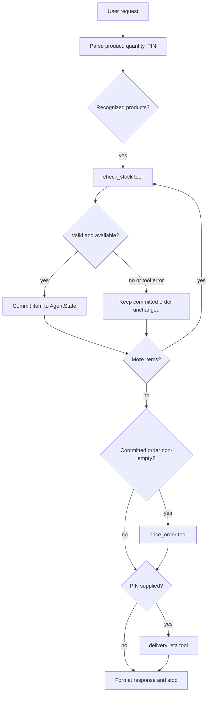

# Design: Store Assistant Agent

## 1. Architecture

The project separates request orchestration, state/contracts, business tools, and editable JSON data. `StoreAssistantAgent` is a small deterministic controller. It parses configured product names and aliases, then routes to only the tools needed to answer the turn.

## 2. Agent versus normal LLM prompting

A normal prompt asks a model to produce an answer in one generation. It does not itself guarantee inventory was checked, arithmetic is correct, failed items were excluded, or a delivery estimate came from configured data. This agent has executable tools, typed contracts, persistent state, a controller that chooses action order, and an observable stopping condition. The request parser here is deliberately deterministic rather than a language model; the architecture keeps parsing and tool execution separate so a provider-backed parser could later be added.

## 3. ReAct loop

For every request the controller selects an action, calls its tool, observes the structured result, updates state, then routes to the next action. The loop terminates after eligible stock checks, optional pricing, optional delivery lookup, and response formatting. Safe execution traces make these transitions inspectable without saving hidden chain-of-thought.

## 4. Three tool contracts

- `check_stock(product_id, quantity)`: validates a positive integer request, looks up inventory, and reports product name, requested and available quantities, availability, unit price, or a structured error.
- `price_order(items)`: validates each product and quantity, calculates line totals and subtotal, selects the highest configured eligible discount, and returns the discount and final total. The agent calls it only with committed, successfully stock-checked order lines.
- `delivery_eta(destination_pin)`: uses the PIN table for known six-digit PINs and a configured default for unknown or invalid values.

Each tool exports a `ToolContract` with a name, description, input schema, and output schema. `src/tools/` is the sole implementation home for the business operations.

## 5. State structure

`AgentState` keeps conversation messages, committed `OrderItem` records, checked inventory, subtotal, discount amount, final total, current destination PIN, delivery estimate, accumulated tool results, errors for the current turn, completion status, and stop reason. `process(request, state)` mutates and returns the same state, allowing subsequent turns to build on the order.

## 6. Nodes and edges

There is no external graph framework. The nodes are request parsing, stock checking, order commit/rejection, pricing, delivery estimation, and response formatting. Edges are explicit in `process`: check each identified item in order, then price if the committed order is non-empty, then estimate delivery if a PIN is present, then stop. Failed or malformed tool results route to safe error handling, never to committing the item.

## 7. Function/tool calling

The controller dispatches using a registry keyed by the exact three tool names. It calls the function with validated structured arguments, records input and output, checks required result fields, and updates state only after validation. This is the same important boundary as model function calling: the assistant selects a named operation and supplies schema-shaped arguments, while application code executes the operation and returns observations.

## 8. Multi-step planning

The request is converted to ordered `(product_id, quantity)` entries plus an optional PIN. Each item is checked before commitment; multiple products get separate stock calls. Pricing aggregates only committed lines. Delivery is a separate conditional step, and the final response combines the result with any errors. Repeated additions check the cumulative requested quantity against stock before changing the line.

## 9. Stopping conditions

The controller stops once every recognized item has been checked, the committed order has been priced if non-empty, and a supplied PIN has been evaluated. If no product is recognized, it returns a clarification/error response and does not call pricing. Every completed turn sets `completed=True` and `stop_reason="request_answered"`; a final trace step has `next_action="stop"`.

## 10. Error handling

Invalid quantities, unknown IDs, missing data, malformed tool output, and raised tool exceptions become concise structured errors. A failed stock check cannot commit the item. A price or shipping error retains the last valid corresponding state. A PIN that is not a six-digit known service area still receives the default ETA, with an explanatory marker when malformed.

## 11. Trace format

Each JSON trace includes the user request, a compact prior-order snapshot, ordered steps, the selected tool and its input/output, state update, next action, final response, and stop reason. It is an execution log, not a reasoning transcript; no private chain-of-thought is generated or stored.

## 12. Why an agent helps here

The task has dependencies that a single unstructured completion can easily skip: availability gates order commitment, pricing depends on the final committed lines, and delivery depends on an optional destination. An explicit agent makes those dependencies enforceable, repeatable, testable, and visible to the user.

## 13. Limitations and possible improvements

The local parser recognizes only names and aliases in the inventory file and uses nearby quantities; it is not general language understanding. Data is local JSON with no concurrency control or live inventory reservation. State persistence is in-memory for one CLI session. An extension could add a configurable LLM parser, a database-backed catalog and conversation store, inventory reservation/checkout, richer address validation, localization, and currency-safe decimal pricing while preserving the same tool boundaries.