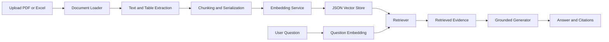

# Classic RAG Document Chat: Project Guide

## 1. Project Purpose

This project is a classic Retrieval-Augmented Generation (RAG) application for chatting with PDF and Excel documents.

The user uploads documents, the application extracts their content, breaks the content into searchable chunks, creates vector embeddings, stores those vectors, and retrieves the most relevant evidence when a question is asked. The answer is generated only from the retrieved evidence and includes citations showing where the information came from.

The browser interface is implemented with Streamlit. The same RAG pipeline can also be run from the command line for evaluation and benchmarking.

## 2. What This Project Demonstrates

- Upload and process PDF, XLSX, and XLS files.
- Extract PDF text and PDF tables.
- Extract Excel rows from every worksheet.
- Support multiple chunking strategies for PDF text.
- Support multiple Excel serialization strategies.
- Convert document chunks and questions into vectors.
- Retrieve the most relevant chunks for a question.
- Generate a grounded answer with citations.
- Refuse to invent an answer when the documents do not contain the requested information.
- Evaluate answer accuracy using a ground-truth question set.
- Compare Excel serialization strategies.
- Display the complete workflow in a browser.

## 3. High-Level Flow



### Upload and ingestion flow

1. The user uploads one or more PDF or Excel files from the Streamlit sidebar.
2. `web_app.py` saves the uploaded files into a temporary session workspace.
3. The UI creates a `Settings` object with the selected chunking, serialization, and top-k options.
4. `RAGPipeline.ingest()` identifies supported files and sends each file to the correct loader.
5. Loaders extract text, tables, worksheets, rows, and source metadata.
6. The extracted content is divided into `DocumentChunk` objects.
7. `EmbeddingService` converts every chunk into a vector.
8. `VectorStore` stores the text, metadata, and vector in `chunks.json`.

### Question and answer flow

1. The user enters a question in the browser.
2. The question is converted into an embedding using the same embedding service.
3. `Retriever` compares the question vector with stored chunk vectors.
4. The top-k closest chunks are selected.
5. `context.py` builds a prompt containing only the retrieved evidence and source metadata.
6. The generator produces an extractive mock answer by default, or an OpenAI answer when configured.
7. Citation strings are built from the actual document metadata.
8. The browser displays the answer, citations, and expandable retrieved evidence.

## 4. File-by-File Explanation

### Browser and command-line entry points

#### `web_app.py`

The Streamlit browser application.

Main responsibilities:

- Creates the browser page with **Chat**, **Browse Chunks**, and **Quality Gate** tabs.
- Accepts PDF and Excel uploads.
- Exposes PDF chunking, Excel serialization, and top-k controls.
- Creates a temporary workspace for uploaded documents.
- Runs document ingestion when the user clicks **Ingest documents**.
- Accepts a user question and displays the answer, generation mode, citations, and retrieved evidence.
- Browses indexed chunks with their source metadata.
- Runs the 20-question golden-set evaluator and displays metrics, release status, per-question results, and the Top-5 failure analysis.
- Shows helpful errors when a document cannot be parsed or a question cannot be answered.

This is the file used for the live demo:

```powershell
python -m streamlit run web_app.py
```

#### `main.py`

The command-line entry point for developers and automated evaluation.

Supported commands:

- `ingest`: process documents and build the vector store.
- `query`: ask one question from the command line.
- `evaluate`: run all ground-truth questions.
- `excel-benchmark`: compare Excel serialization formats.
- `report`: print the generated Markdown report.

Example:

```powershell
python main.py ingest --input data/documents
python main.py query --question "What is the operating temperature range?"
python main.py evaluate
```

### Configuration and data models

#### `app/config.py`

Defines the `Settings` dataclass used throughout the application.

It controls:

- Document directory.
- Vector-store directory.
- Results directory.
- PDF chunking strategy.
- Excel serialization strategy.
- Number of chunks retrieved.
- Similarity threshold.
- Embedding model.
- LLM model and generation settings.

It also reads environment-variable overrides such as `EMBEDDING_MODEL`, `TOP_K`, and `LLM_API_KEY`.

#### `app/models.py`

Defines the Pydantic data models exchanged between modules:

- `DocumentChunk`: text plus metadata and optional embedding.
- `RetrievedChunk`: a document chunk plus distance and similarity score.
- `Answer`: answer text, citations, retrieved chunks, and generation mode.

These models keep the interfaces between loaders, retrieval, generation, and the UI consistent.

### Document loading and preparation

#### `app/loaders.py`

Chooses the correct parser based on file extension.

For PDFs it:

- Uses `pypdf` to extract page text.
- Preserves the PDF filename and page number as metadata.
- Uses `pdfplumber` to extract tables when available.
- Labels extracted tables with `table_id` and `chunk_type=table`.

For Excel files it:

- Uses pandas to read every worksheet.
- Converts rows into the selected text representation.
- Preserves filename, worksheet, row, and serialization metadata.

#### `app/pdf_tables.py`

Provides the PDF-table module surface. PDF table extraction is currently performed directly in `app/loaders.py` through `pdfplumber`; this module remains available as a separation point for future table-specific improvements.

#### `app/excel_serializer.py`

Converts Excel rows into one of three searchable text formats:

- `row_text`: one readable line per row.
- `markdown_table`: table-style text with headers.
- `column_wise`: one line per column containing its values.

These representations can affect retrieval quality, so the project benchmarks them.

#### `app/chunking.py`

Splits extracted PDF text into manageable `DocumentChunk` objects.

Available strategies:

- `fixed`: fixed-size character windows.
- `recursive`: paragraph-oriented chunks with overlap.
- `section-aware`: attempts to preserve heading-based sections before splitting.

Overlap helps preserve context when an important sentence crosses a chunk boundary.

### Embeddings, storage, and retrieval

#### `app/embeddings.py`

Converts text into numerical vectors.

Default behavior:

- Attempts to use the local `all-MiniLM-L6-v2` Sentence Transformers model.
- Falls back to deterministic hashing embeddings if the model is unavailable.
- Supports `EMBEDDING_MODEL=hash` for fast offline execution.

The fallback is lexical rather than truly semantic, but it keeps the project deterministic and runnable without downloading a model.

#### `app/vector_store.py`

Implements a small JSON-backed vector store.

It:

- Adds chunks and their embeddings.
- Persists them to `data/vector_store/chunks.json`.
- Loads the persisted vectors for later queries.
- Calculates Euclidean distance between the question vector and document vectors.
- Converts distance to a score using `1 / (1 + distance)`.
- Returns the top-k closest chunks.

In production, this interface could be replaced by Chroma, pgvector, or another vector database without changing the rest of the pipeline.

#### `app/retrieval.py`

Defines the `Retriever` class. It embeds the user question, searches the vector store, applies top-k and optional threshold settings, and returns ranked evidence.

### Context, generation, and citations

#### `app/context.py`

Builds the grounded context supplied to the generator.

The context instructs the generator to:

- Answer only from the supplied evidence.
- Avoid inventing facts.
- Refuse when the answer is missing.
- Include citations based on metadata.

#### `app/generator.py`

Defines the answer-generation layer.

It supports two modes:

- `mock`: deterministic extractive generation used by default. It selects matching lines from retrieved chunks.
- `llm`: OpenAI-backed generation when a model and `LLM_API_KEY` are configured.

The mock mode is intentionally labeled in the UI so it is not confused with a hosted LLM response.

#### `app/citations.py`

Converts metadata into readable citations such as:

```text
[spec.pdf, page 2]
[sales.xlsx, Summary sheet, row 4]
```

Citations use the actual source, page, sheet, row, and table metadata created during loading.

### Pipeline and evaluation

#### `app/pipeline.py`

The main orchestration layer.

`RAGPipeline.ingest()` coordinates loading, chunking, embedding, and persistence.

`RAGPipeline.query()` coordinates loading the vector store, retrieving evidence, assembling context, generating an answer, and creating citations.

Both the CLI and browser UI use this class, which keeps the core behavior consistent.

#### `app/evaluation.py` and `main.py`

Provide the original Week-2 evaluation and Excel serialization benchmark. The classic evaluation writes `results/classic_evaluation_results.json` and `results/evaluation_report.md`; the benchmark writes `results/excel_benchmark.json`.

#### `evaluate.py` and `evaluation/`

Run the separate RAG Quality Gate against `data/golden_dataset.json`, reusing `RAGPipeline` rather than duplicating the RAG application. The evaluator records retrieved chunk text, answers, citations, metric values, question-level status, and failure classification. It writes `results/evaluation_results.json`, `results/evaluation_results.csv`, `results/scorecard.md`, and `results/failure_analysis.md`.

The deterministic evidence metrics are calculated from this pipeline run. RAGAS and the structured JSON LLM judge are optional provider-backed evaluations; they display as disabled or not configured when their prerequisites are absent. Do not present N/A as a score.

#### `tests/test_rag.py`

Contains automated tests for the core RAG behavior. Run them with:

```powershell
python -m pytest
```

### Project support files

#### `generate_sample_data.py`

Generates the sample PDF, Excel workbook, and chart image used by the assessment.

#### `requirements.txt`

Lists Python dependencies, including pandas, PDF parsers, openpyxl, Sentence Transformers, OpenAI, pytest, and Streamlit.

#### `.env.example`

Documents configurable environment variables without storing secrets.

#### `.gitignore`

Excludes local environments, caches, `.env`, and generated vector-store files from Git.

#### `data/`

Contains input documents and ground-truth questions.

#### `results/`

Contains generated evaluation reports and benchmark output.

## 5. Demo Presentation Flow

### Before the demo

From the project root, make sure the sample PDF and Excel workbook exist in `data/documents/`. If they need to be regenerated, run:

```powershell
python generate_sample_data.py
```

Start the Streamlit application. Use a free port if another local Streamlit app is already using 8501:

```powershell
python -m streamlit run web_app.py --server.port 8502
```

Open the URL printed by Streamlit, for example `http://localhost:8502`. The browser app has three tabs: **Chat**, **Browse Chunks**, and **Quality Gate**. The Quality Gate evaluates the repository golden documents and dataset; it is separate from the files uploaded for an interactive chat session.

To confirm the evaluator and saved outputs before presenting, run:

```powershell
python evaluate.py
python -m pytest -q
```

The gate command exits with status 1 for a failing release gate. That is expected for the current mock-generator baseline described below, not a test-suite error.

### Suggested 7-minute walkthrough

1. **Frame the problem (45 seconds).** Explain that a plausible answer is not enough for release; the system must retrieve evidence, answer from it, and abstain when the documents do not contain the answer.
2. **Show ingestion (60 seconds).** In the sidebar, point out PDF/Excel upload, PDF chunking, Excel serialization, and top-k. Upload `data/documents/spec.pdf` and `data/documents/sales.xlsx`, then click **Ingest documents**.
3. **Show the pipeline evidence (60 seconds).** Open **Browse Chunks**. Filter by source and show that PDF page/table and Excel sheet/row metadata are retained with the text.
4. **Ask a supported PDF question (45 seconds).** In **Chat**, ask: “What is the operating temperature range?” Show the extracted `-10 C to 55 C` answer, its citation, generation mode, and retrieved chunks.
5. **Ask a spreadsheet question (45 seconds).** Ask: “What were West's Q1 sales in the spreadsheet?” Show `3500` and the retrieved `sales.xlsx` row evidence.
6. **Run the release check (90 seconds).** Open **Quality Gate** and click **Run Evaluation**. Show the overall release decision, metric cards with threshold comparisons, and the 20-row question scorecard. Expand a failed item under **Top-5 failures** to show the bot answer, root cause, retrieved evidence, and recommended fix.
7. **Explain the result honestly (90 seconds).** The latest saved run is **DO NOT SHIP**: context precision `0.970`, context recall `1.000`, hit rate `1.000`, faithfulness `0.700`, answer relevance `0.700`, and correct refusal rate `0.000`. Fourteen answerable questions pass; all six unanswerable questions fail because the current mock generator returns unrelated retrieved text instead of refusing. Their classification is `GENERATION_ERROR`, so the next targeted change belongs in abstention/generation behavior rather than the retriever.
8. **Close on the gate (30 seconds).** State that the release thresholds are explicit, failures are traceable, and this baseline should not ship until the refusal and answer-quality metrics meet their thresholds.

### Presenter script

> This demo makes the retrieval-augmented generation path observable. We ingest PDF and Excel content through the existing Week-2 loaders, preserve source and location metadata on chunks, embed and index those chunks, then retrieve evidence for each question. The chat view exposes answers, citations, and retrieved context. The Quality Gate runs a separate 20-question golden set through the same RAG pipeline and compares answers and retrieved evidence with known facts. The release decision is currently FAIL. Retrieval metrics are strong on this dataset, but the mock generator does not abstain correctly on the six unanswerable questions. We are surfacing that as a generation failure instead of claiming the bot is ready to release.

### Demo questions

- PDF fact: “What is the operating temperature range?” Expected fact: `-10 C to 55 C`.
- Excel fact: “What were West's Q1 sales in the spreadsheet?” Expected facts: `West`, `3500`.
- Unanswerable evaluation item: “What is the battery capacity of the Acme Sensor?” Correct behavior: refusal. In the current baseline the bot does not reliably refuse; use the Quality Gate result to show the failure, not as a successful chat demo.

## 6. How to Explain the Important Controls and Metrics

### Chunking strategy

Chunking controls how PDF text is divided before indexing. Smaller or better-structured chunks can improve retrieval because the retrieved evidence is more focused.

### Excel serialization

Excel data is converted into text before embedding. Different representations expose different relationships between headers and values. The benchmark compares these formats instead of assuming one is always best.

### Top-k

Top-k controls how many document chunks are retrieved for each question. A larger value provides more context but can introduce unrelated text. A smaller value is more focused but may miss supporting evidence.

### Similarity score

The vector store ranks chunks by distance from the question vector. Lower distance means the chunk is considered more similar. The UI displays a converted score for readability.

### Mock mode versus LLM mode

The default mock mode is deterministic and works without an API key. It extracts matching lines from the evidence. With an LLM model and `LLM_API_KEY` configured, the generator can use OpenAI for more natural answers.

### Quality-gate metrics

- **Context precision** estimates whether relevant expected facts occur near the top of retrieved chunks. Higher is better; irrelevant chunks dilute the score.
- **Context recall** measures how many required golden facts appear anywhere in retrieved evidence.
- **Retrieval hit rate** measures whether at least one expected source document was retrieved for each answerable question.
- **Faithfulness** checks whether required answer facts are supported by retrieved evidence. The current offline implementation is deterministic fact matching, not an LLM semantic-claim audit.
- **Answer relevance** checks whether the answer contains the required golden facts. Refusing an answerable question receives no credit.
- **Correct refusal rate** measures refusal on the deliberately unanswerable subset. Correct refusals pass; unsupported answers fail.
- **LLM-as-Judge** is a structured JSON evaluation on a 1-5 scale, normalized to 0-1. It is N/A until a judge API key and model are configured.
- **RAGAS** can be enabled separately with its optional dependencies and provider credentials. If it is disabled or unavailable, say so; do not describe the custom offline metrics as RAGAS output.

The default thresholds are faithfulness >= 0.80, answer relevance >= 0.80, context precision >= 0.75, context recall >= 0.75, retrieval hit rate >= 0.80, and correct refusal rate >= 0.90. The Quality Gate tab displays each measured score alongside its threshold.

## 7. Limitations to Mention Honestly

- The JSON vector store is a simple local reference implementation, not a production distributed database.
- Hashing embeddings are a fallback and are less semantic than a trained embedding model.
- PDF image-only chart values are not reliably extracted by text parsing.
- OCR or a vision-capable model would be needed for dependable chart-image question answering.
- The default mock generator is extractive and is not equivalent to a production LLM.
- Uploaded files are stored in a temporary local session workspace for the browser run.
- The current saved quality-gate run is a failing baseline: 14 of 20 questions pass; the six unanswerable questions are incorrectly answered.
- The local precision, recall, faithfulness, and relevance calculations use deterministic matching against golden facts. They are useful regression signals but are not substitutes for semantic RAGAS evaluation or a calibrated judge.
- LLM-as-Judge and RAGAS are optional and show N/A/disabled unless explicitly configured and run.

## 8. One-Minute Summary

This project reuses the Week-2 PDF/Excel RAG pipeline and adds a release-quality gate around it. The browser exposes chat, indexed chunks, and an evaluation scorecard over 20 golden questions. The gate reports retrieval, answer quality, correct refusal, per-question PASS/FAIL, and targeted failure analysis. The current run is deliberately presented as DO NOT SHIP because the bot fails all six unanswerable questions; the report makes the next fix measurable instead of hiding the gap.
